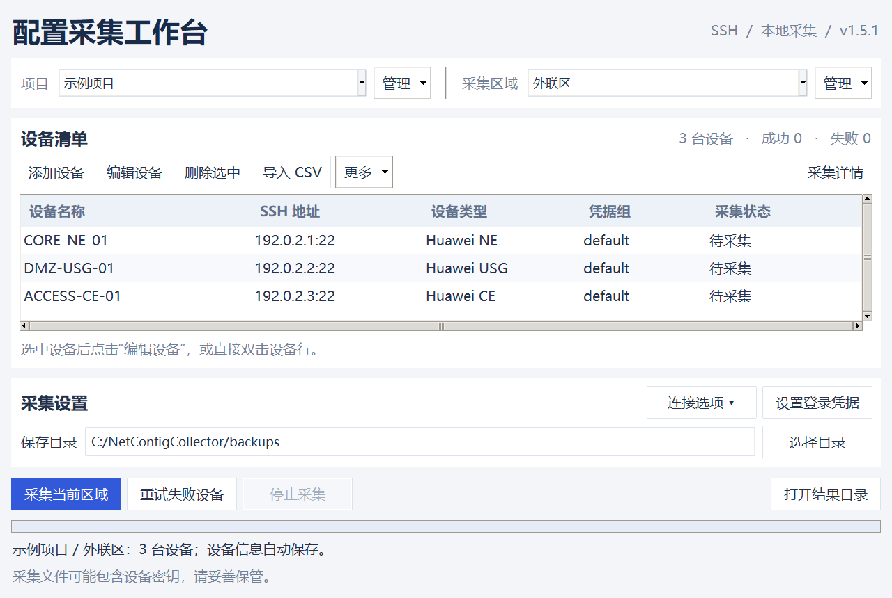

# NetConfig Collector

Windows 图形界面的网络设备配置批量采集工具。当前版本：**1.5.1**。

支持华为 NE / AR / CE / USG、H3C Comware 和山石 StoneOS 的通用 SSH 采集流程。

## 功能

- 项目 / 区域设备库：清单自动保存，重启恢复上次选择，选择区域即可采集。

- CSV 导入、手动添加、编辑设备、保存清单。
- 凭据组管理，登录密码仅保存在本次会话内存中。
- 并发 SSH 采集、阶段状态、停止操作、失败设备重试。
- 每次采集或重试使用独立目录，单台配置文件及 CSV 结果汇总。
- 华为 USG 的 HRP_M / HRP_S 提示符识别。
- 首次 SSH 指纹默认自动信任，可改为手动确认；已知密钥变化仍拒绝连接。

## 从源码运行

需要 Windows 和带 Tkinter 的 Python 3.12。仓库不包含构建产物。

~~~powershell
py -3.12 -m venv .venv
.\.venv\Scripts\python.exe -m pip install -r source/requirements-build.txt
.\.venv\Scripts\python.exe source/app.py
~~~

devices.csv 是模板，地址 192.0.2.x 必须替换为实际设备地址。
先新建项目和区域，再导入各区域清单；每次启动填写项目登录凭据后，切换区域采集。
详细流程见 [使用说明](docs/使用说明.md)。

## 测试

~~~powershell
.\.venv\Scripts\python.exe -m unittest discover -s source -p "test_*.py"
~~~

测试需要可创建桌面窗口的 Windows 会话。72 项测试覆盖采集、界面编辑及失败重试。
SSH 测试使用本机模拟服务器，不连接业务设备。测试中凭据均为虚构数据。

## 构建 Windows EXE

~~~powershell
.\.venv\Scripts\python.exe -m PyInstaller --noconfirm --onefile --windowed --name NetConfigCollector --distpath dist --workpath build --specpath build source/app.py
.\dist\NetConfigCollector.exe --smoke-test
~~~

## 范围与限制

- 仅采集当前运行配置，不执行 save、commit 或配置恢复。
- 适配以通用 CLI 为基础；模拟测试不替代真实设备验证。
- 采集文件可能包含设备密钥等敏感配置，本工具不加密或脱敏这些文件。
- 实际清单、凭据、采集结果及 known_hosts 不应提交到仓库。
- 第三方依赖许可文本位于 [source/third-party-licenses](source/third-party-licenses)。

## 文件

- source/app.py：图形界面与批量任务。
- source/collector.py：SSH、提示符、分页、配置校验。
- source/test_*.py：自动化测试。
- docs/使用说明.md：使用说明与版本更新。

## 本地设备库

设备清单保存于 %LOCALAPPDATA%\NetConfigCollector\inventory.json，
上一版备份为 inventory.json.bak。该目录独立于程序解压目录，升级程序可继续使用。
仅保存项目、区域及设备名称 / 地址 / 类型 / 端口 / 凭据组名称，不保存登录密码。

采集结果目录：保存目录 / 项目 / 区域 / 时间戳。
删除项目或区域只删除设备库条目，保留已有采集文件。
设备库属于本地业务数据，请勿提交到公开仓库。

## v1.5.0 界面更新

顶部选择项目 / 区域，各自的“管理”菜单可新建、重命名或删除。下方显示设备及采集操作。
导出清单和模板位于设备工具栏的“更多”菜单。
并发数、超时、编码和首次信任指纹选项位于“连接选项”，点击即可展开。
原有设备库位置和采集逻辑保持兼容。

## v1.5.1 显示修复

项目与区域改为顶部并排选择，管理操作收纳到各自菜单。设备操作按钮根据文字自然宽度显示，修复“导入 CSV”等按钮截断。
