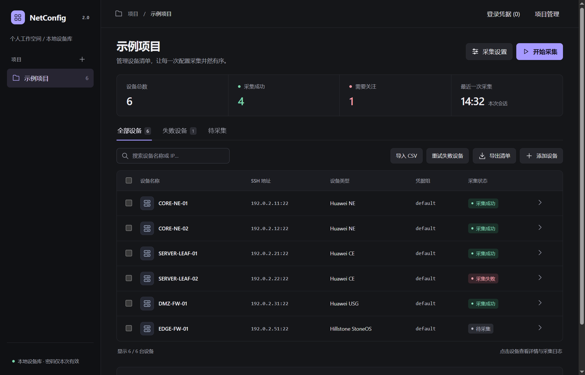

# NetConfig Collector

Windows 独立网络设备配置采集工具，当前版本 **2.0.0**。
新版使用本地 WebView 界面与 Python SSH 核心；无需 Node.js、npx 或联网加载网页资源。

## 使用

1. 解压工具包，运行 NetConfigCollector.exe。
2. 左侧新建或选择项目，添加设备或导入 CSV。
3. 点击顶部“登录凭据”，填写设备使用的凭据组、用户名和密码。
4. 在“连接设置”选择保存目录，点击“开始采集”。

要求：Windows x64、Microsoft Edge WebView2 Runtime、.NET Framework 4.6.2 或更高版本。
如提示缺少 WebView2，请从 [Microsoft 官方页面](https://developer.microsoft.com/microsoft-edge/webview2/) 安装运行时。
安装完成后，采集仅需能连接设备，不需要访问互联网。

## 功能

- 项目设备库自动保存，兼容 v1.6/v1.7 数据；更早的区域设备库自动备份迁移。
- 添加、编辑、批量删除设备，CSV 导入/导出和模板导出。
- 名称/IP 搜索、状态筛选、设备详情抽屉及实际采集阶段日志。
- 项目凭据隔离，账号密码仅在本次会话内存中保存，不进入设备库或界面状态响应。
- 并发采集、停止、失败/已停止设备重试；重试保留成功结果。
- 首次 SSH 指纹默认自动信任，可在连接设置中关闭；已知密钥变化仍拒绝连接。
- 单台配置、SHA-256、results.csv 和 SSH 协商诊断日志。

支持 Huawei NE / AR / CE / USG、H3C Comware、Hillstone StoneOS 通用 CLI。
仅读取运行配置，不执行 save、commit 或进入配置模式。真实型号与版本兼容性仍需现场验证。

## 本地数据

设备库：%LOCALAPPDATA%\NetConfigCollector\inventory.json。
配置结果：保存目录 / 项目 / 时间戳，重试使用 retry_时间戳。
升级程序不会清空设备库。历史采集目录保持原样；运行状态和凭据不跨程序重启保存。
采集文件可能包含设备密钥，本工具不对配置文件加密或脱敏。
实际清单、凭据、known_hosts 和采集文件不得提交公开仓库。

## 从源码运行与测试

~~~powershell
py -3.12 -m venv .venv
.\.venv\Scripts\python.exe -m pip install -r source/requirements-build.txt
.\.venv\Scripts\python.exe source/desktop.py
.\.venv\Scripts\python.exe -m unittest discover -s source -p "test_*.py"
~~~

94 项测试包含原 SSH 核心/设备库回归和新增桌面 API 测试。SSH 测试使用本机模拟服务器，不连接业务设备。
另验证了真实 WebView JS→Python→本机 SSH 调用链，以及正式 HTML 的 12 组尺寸/缩放组合。

构建命令见 [BUILD.md](source/BUILD.md)，使用详情见 [使用说明](docs/使用说明.md)。
source/desktop.py 是新版入口，desktop.html 是界面，desktop_api.py 是本地桥接。
collector.py 和 inventory.py 保持原有核心逻辑；app.py 保留旧版 Tkinter 界面用于回归。
第三方许可和声明位于 source/third-party-licenses。
